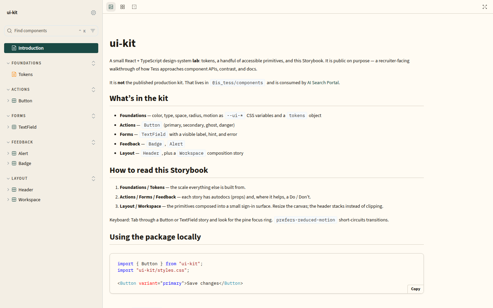
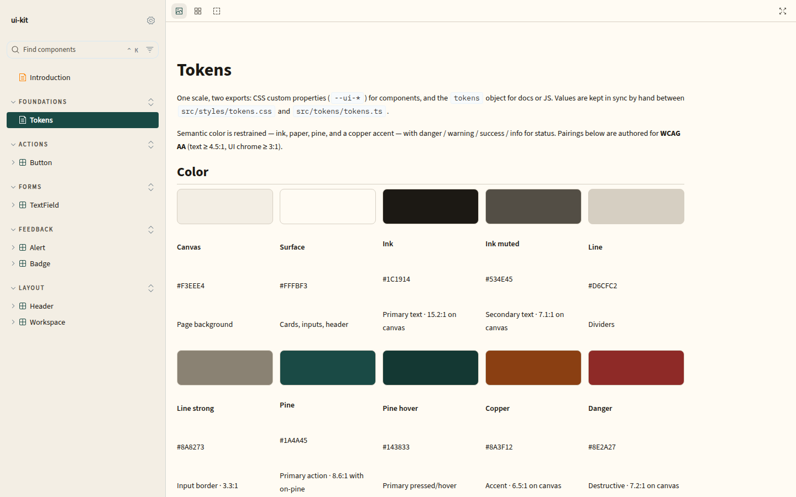
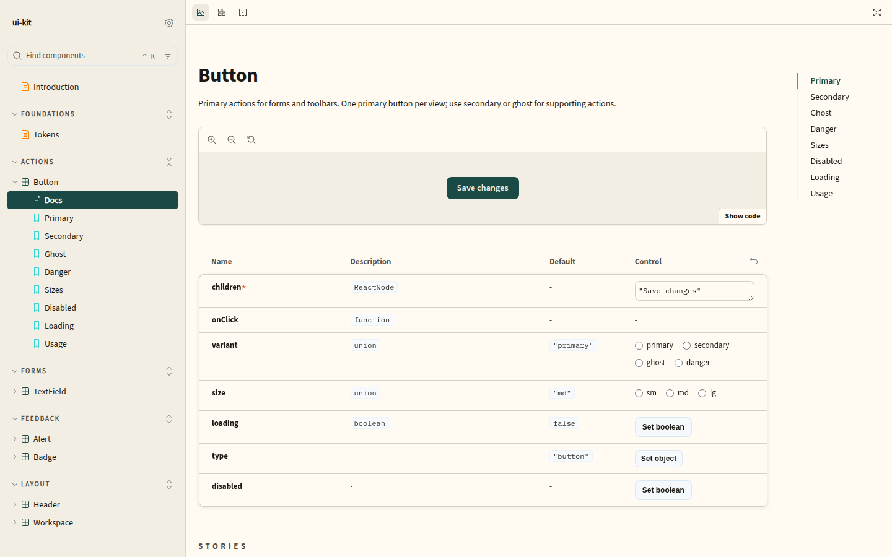
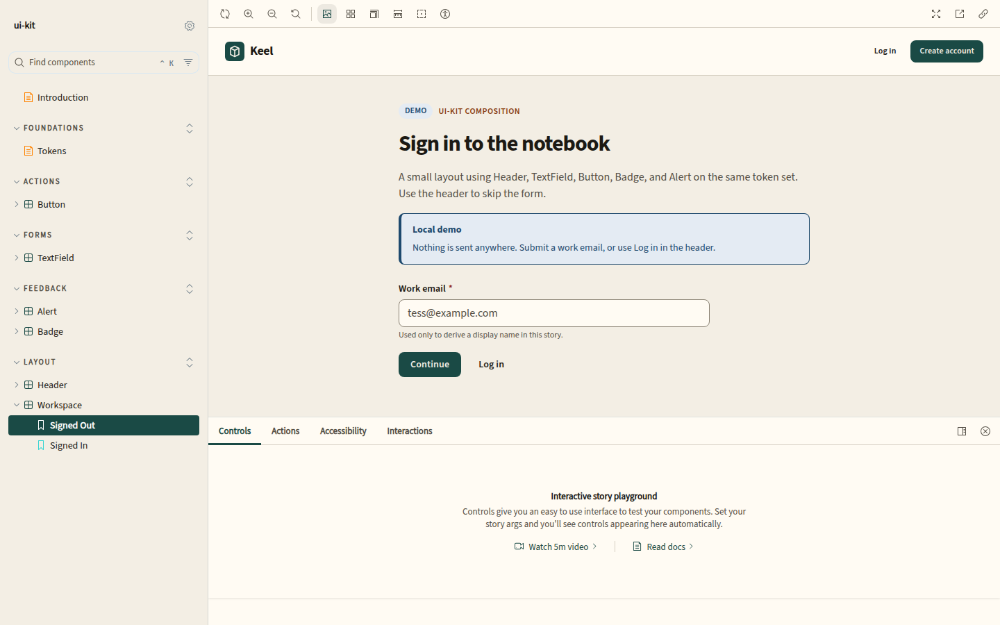

# ui-kit

A small React + TypeScript **design-system lab**: CSS tokens, accessible primitives, and Storybook. Built as a public, recruiter-facing walkthrough of component API and a11y decisions — not a published production package.

Production UI lives in [`@is_tess/components`](https://www.npmjs.com/package/@is_tess/components) and [AI Search Portal](https://github.com/tessOu56/ai-search-portal).



## What’s in the library

- **Tokens** — spacing, type, radius, motion, and a restrained pine/paper palette with WCAG AA semantic color
- **Button** — primary, secondary, ghost, danger; sizes; disabled and loading (`aria-busy`)
- **TextField** — visible label, hint, error, required
- **Badge** and **Alert** — status tones with the right `role`
- **Header** — application chrome that stacks on small viewports
- **Workspace** — a composition story (not a public export) showing the primitives together

## Install and use

This repo is a lab. Clone it, then:

```bash
pnpm install
pnpm build
```

```tsx
import { Button } from "ui-kit";
import "ui-kit/styles.css";

<Button variant="primary">Save changes</Button>
```

Peer dependency: React 19. Import `ui-kit/styles.css` once at the app root so tokens and component CSS load.

## Storybook and tests

```bash
pnpm storybook          # http://localhost:6006
pnpm build-storybook    # static build → storybook-static/
pnpm test               # Jest + Testing Library
```







Start at **Introduction**, then **Foundations / Tokens**, then a component. Each component story includes autodocs; Button and TextField also have Do / Don’t examples.

## Stack

React 19, TypeScript, Tailwind 4 (token bridge + Storybook), tsup, Storybook 8, Jest, Changesets, pnpm.
